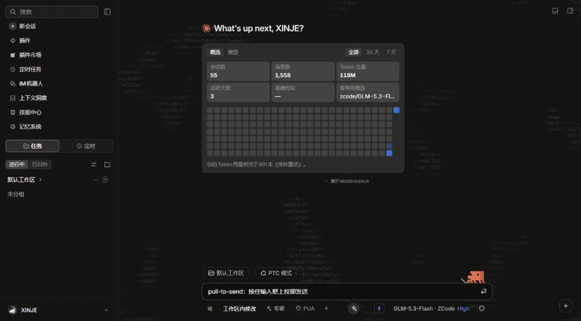

# PULLTOSEND

按住 DSH 输入框、向上拉、松手 —— 消息飞出去。为「发送按钮太小难点、Enter 要动两只手」而生。

[English](./README.en.md)



## 安装

```bash
dsh plugin --profile desktop add "github:dhdkfkfkf/PULLTOSEND"
```

装完重启一次 DSH（添加 bundle 本身需要重启；之后改代码走 dsh-hmr 热更）。

## 手势

| 动作 | 结果 |
| --- | --- |
| 在输入框卡片上按下，向上拉出卡片上边缘 ≥24px | 武装：输入框副本拎起，跟随指针（阻尼跟随、微放大、阴影加深），真输入框缩小变暗 |
| 武装后松手 | 点击发送按钮的当前主行为（空闲=发送，生成中=排队/插话），副本 FLIP 飞入新消息气泡，真气泡交叉淡入 |
| 未拉出阈值 / 横向拖拽占优 / 按 Esc / pointercancel | 取消：副本沿原路 320ms 弹回 |

| 不打断你 | 说明 |
| --- | --- |
| 框内拖选 | 手势只在指针越出上边缘后才武装，框内选择 100% 原生 |
| 空输入 / 发送按钮禁用 | 不武装，松手无事发生 |
| IME 组合中 | 组合一开始就取消手势，不会发出半截拼音 |
| 触屏 | 仅响应鼠标和笔，手指滚动永远不会误发 |
| 卡片上的按钮 / 链接 / 菜单 | 归它们自己，不会拉出消息 |

## 动画参数

零构建、单文件 `client.js`，所有参数是文件顶部的具名常量（v1 没有设置面板）：

| 常量 | 默认 | 含义 |
| --- | --- | --- |
| `ARM_DISTANCE` | 24px | 越过输入框上边缘多少距离才武装 |
| `DAMPING` | 0.9 | 副本跟随指针的每帧插值系数 |
| `MAX_SCALE` | 1.02 | 拎起时最大放大 |
| `FLIP_MS` | 400ms | 松手后副本飞入气泡的时长 |
| `BUBBLE_LEAD_MS` | 80ms | 真气泡提前淡入的提前量 |
| `RETURN_MS` | 200ms | 真输入框回位时长（不等飞行结束） |
| `CANCEL_MS` | 320ms | 取消回弹时长 |

## 兼容性

同时兼容 claude-style 与原生界面（两者共用同一套 `data-composer-*` 锚点）；多个会话窗格各自绑定各自的手势。已验证发送路径：对发送按钮的程序化 `.click()` 在 React/Lexical 下真实触发发送（CDP 探针实测）。

## License

MIT
